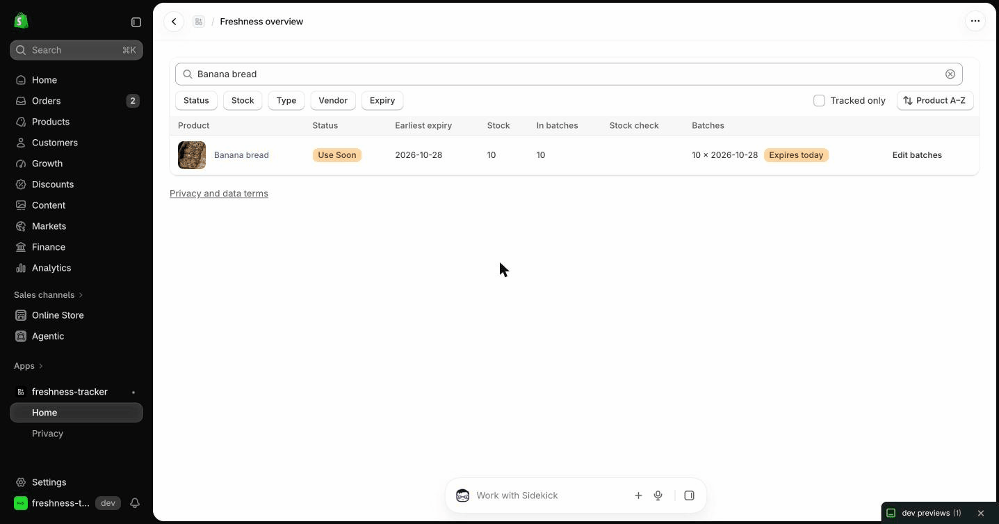
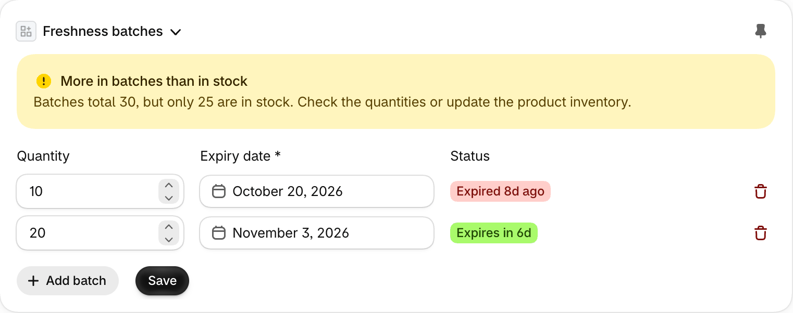
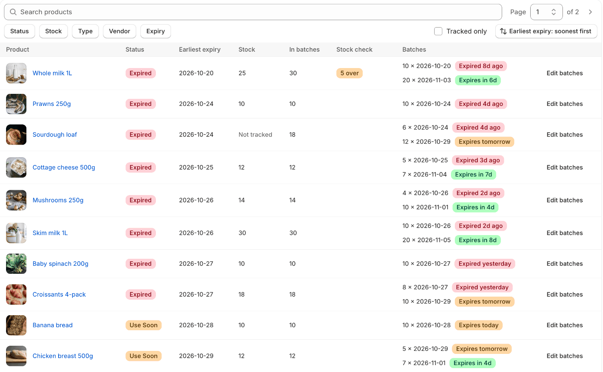
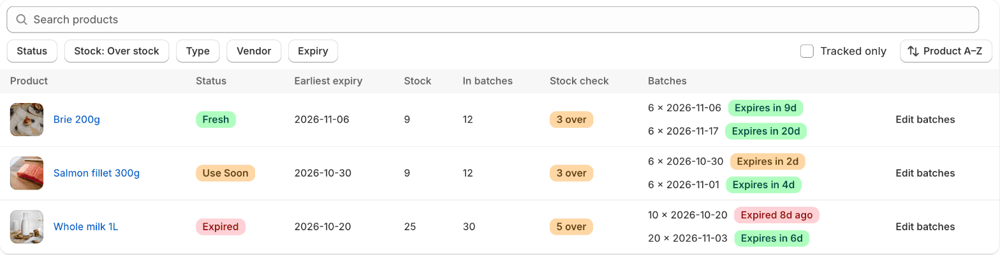
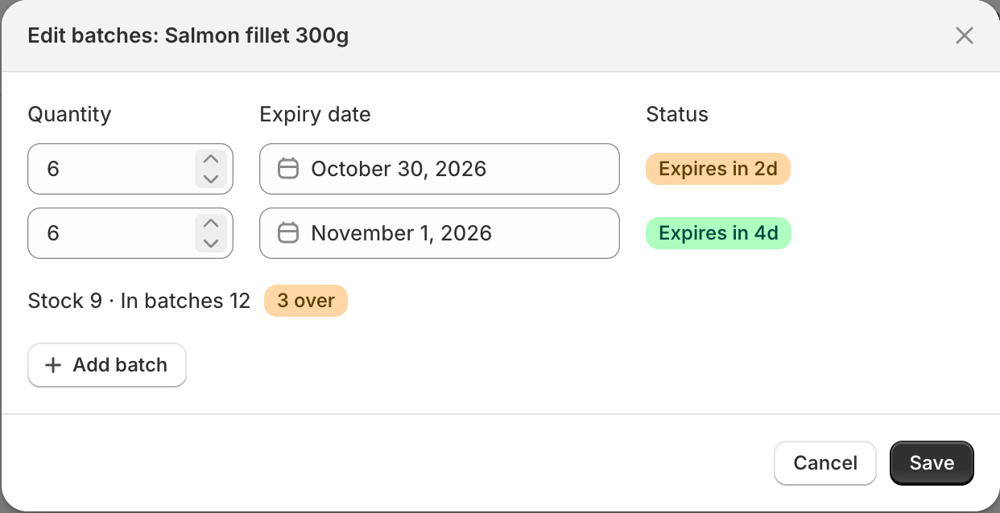

# Shopify Freshness Tracker

An embedded Shopify app for stores that sell perishable goods. Merchants record stock in **batches**, each with a quantity and an expiration date, and see which products are fresh, close to expiry or expired. When an order is fulfilled, stock comes out of the soonest-expiring batch first (**FEFO**, first expired, first out).

It's a portfolio project, built to show custom Shopify app work end to end.

## Demo

The app runs on a development store with 60 demo food products. It isn't deployed or listed on the Shopify App Store. The GIF and screenshots below were captured on that store. A dev-only reseed page (`/app/dev/seed-demo`) replaces those products' batches with planned ones, dated relative to the day it runs. The products themselves and their photos must already be in the store; the page matches them by handle.



1. **Record batches on the product page.** The panel on each product lists its batches, with a live status badge per row, and warns when they add up to more than the tracked stock.

   

2. **See what's expired or expiring soon.** The dashboard shows each product's status and earliest expiry. Sort by earliest expiry, or filter to "Next 7 days".

   

3. **Spot stock that doesn't match.** The Stock check column flags batches over stock ("5 over") or stock no batch covers ("8 unbatched"). The Stock filter lists just those products.

   

4. **Fulfill an order, and the batches update.** Fulfilling 10 Banana bread takes all 10 units out of its batch. The emptied batch is removed, and the product's earliest expiry is cleared (the GIF at the top). With several batches, units come from the soonest-expiring unexpired one first (FEFO); expired batches are never used.

5. **Edit batches from the dashboard.** Change quantities and dates, or add batches, without opening each product.

   

## Status

| Area                                            | State                                                            |
| ----------------------------------------------- | ---------------------------------------------------------------- |
| Batch tracking on the product page              | Done                                                             |
| Freshness dashboard                             | Done                                                             |
| Fulfillment and compliance webhooks             | Done: signature-verified; fulfillments deduplicated and recorded |
| Decrementing batches when an order is fulfilled | Done: FEFO, per-product lock, retry-safe; shortfalls recorded    |

## Features

**Product page panel** (Admin UI extension on the product details page)

- Add, edit and remove batches, each with a quantity and an expiration date. Every row shows a live status badge.
- Validation: quantity must be a whole number from 1 to 1,000,000,000, and the expiration date is required. Past dates are allowed, because expired stock exists until it's removed.
- A non-blocking warning when the batches add up to more than the product's tracked inventory.
- Load and save errors are shown in the panel, never silently swallowed. Most failed loads can be retried in place.

**Dashboard** (the app's home page)

- Each product's overall status, earliest expiry and a per-batch breakdown, with a thumbnail and a link to its admin page. It shows 50 products per page in the chosen sort order, and up to 10 batches each. A page picker ("Page 3 of 9") jumps to any page; it counts with Shopify's `productsCount` and reaches later pages with cursor-only queries, so only the page shown loads its batches. A batch with 0 units or fewer shows **Sold out** instead of an expiry badge. The app deletes the batches it empties, so this only comes from an edit made outside the app (see Known limitations).
- Stock next to the units in batches, with a **Stock check** column that flags batches over stock ("5 over") or stock no batch covers ("8 unbatched").
- Search, sorting by product, stock, type, vendor or earliest expiry (soonest first, listing products that have an expiry date; Shopify can't sort by a metafield, so the app reads up to 1,000 dates cheaply, sorts them, and then loads only the page shown with its batches), and filters for type, vendor, status, stock check, tracked products and expiry. The expiry filter offers "Already expired", "Today", "Next 7 days", "Next 30 days" (counted from the shop's own date) or a custom range, matched against each product's earliest in-stock expiry by Shopify's search. Sort and filters live in the URL, and clearing the filters keeps the sort.
- An editor per product: change batch quantities and dates, or add new batches (up to 25 per save), including to a product that has none. A running total of stock and batch units updates as you type. Saves take the product's lock and refuse if the batches changed since the editor opened. Removing a batch stays in the product panel.
- An empty state when the store has no products.

**Privacy page** (`/app/privacy`)

- Renders [PRIVACY.md](PRIVACY.md) inside the admin. It's linked from the app nav and the dashboard.

## How it works

```
Product page panel ──writes──▶ freshness_batch metaobjects (quantity, expiration_date)
                               product metafields: freshness_batches (list of batches)
                                                   earliest_expiration_date (readable in Liquid)
Dashboard ──reads──▶ the same metaobjects and metafields through the Admin GraphQL API
Dashboard editor ──writes──▶ the same, under the per-product lock

fulfillments/create webhook ─▶ verify HMAC ─▶ skip duplicates ─▶ group line items by product
                            ─▶ save a job ─▶ reply 200
fulfillment job (started at once, or by a 30s sweep)
                            ─▶ per-product lock ─▶ FEFO plan ─▶ save plan (and any shortfall) ─▶ write batches
```

**Freshness status is computed on every view, never stored.** It comes from each batch's expiration date and the shop's local "today":

| Status   | Rule                           |
| -------- | ------------------------------ |
| Expired  | the expiration date has passed |
| Use Soon | expires today or within 3 days |
| Fresh    | otherwise                      |

A product's status is that of its worst in-stock batch, or **Not set** when it has no in-stock batch with a date.

## Key decisions

- **Plain calendar dates.** Batches store `YYYY-MM-DD`. Days remaining is simple date subtraction in the shop's timezone, the way FEFO and inventory systems count it.
- **Expired stock is never decremented.** FEFO skips expired batches, because packing teams shouldn't ship them. Anything that fresh stock can't cover is reported as a shortfall, never driven negative.
- **A per-product lock** (Prisma, SQLite) serializes batch updates. Batches live in Shopify, not in the app's database, so a transaction can't protect them. The lock expires after 30 seconds, so a crashed holder frees it, and release only deletes the caller's own lock.
- **Reply first, apply after.** Shopify allows 5 seconds for a webhook, and applying a fulfillment takes about 2 seconds per product. The webhook saves a job and replies at once. The job runs straight away, or from a sweep every 30 seconds after a restart. Temporary failures retry over about 4 hours, like Shopify's own retries, and a job plans against the shop date it was received.
- **Save the plan, then write.** Shopify has no transaction across several metaobject writes, so each fulfillment's plan (target quantities, not deltas) is saved first. A retried job finishes a half-applied plan instead of decrementing twice. If a merchant edited the batches in between, the plan is dropped and recorded as a discrepancy.
- **Shortfalls are recorded, not hidden.** When fresh stock can't cover a fulfillment, the gap is saved as an `oversell` or `expired_stock_only` discrepancy, along with deleted products, lists too long to read and writes Shopify rejects. A rejection is recorded instead of retried, so it can't block the product's later fulfillments.
- **`fulfillments/create`, not `orders/paid`.** Stock leaves on shipment, and partial fulfillments arrive as separate events. On a real partial fulfillment, the payload's `quantity` was the units shipped in that fulfillment.
- **Minimal data access.** The scopes are `write_products`, `read_metaobjects` and `read_fulfillments`. The app requests no protected customer fields, which Shopify's docs say are then redacted from payloads, and it stores no customer data.
- **Pure logic in `shared/`.** Freshness, FEFO, validation and grouping are pure functions with unit tests. Routes and the extension call them instead of re-implementing the rules.

## Known limitations

- **The expiry sort covers up to 1,000 products.** It sorts the first 1,000 products with an expiry date, taken in title order, and says so when there are more. The expiry filter narrows a bigger list.
- **Products without an expiry date aren't listed in the expiry sort.** Shopify's search can find products that have a date but not ones missing it.
- **The status, stock check and tracked filters check up to 200 products.** Shopify's search can't see batches, so the app checks the first 200 in the chosen order and says so when there are more. Page counts in these views cover only the products checked.
- **Far pages take longer on large stores.** Shopify has no offset paging, so reaching a later page reads the cursors before it, 250 at a time. The page picker lists every page.
- **Products with more than 250 batches** show partial unit totals, marked with a "+", since the dashboard reads 250 batches per product.
- **The product page panel saves straight to Shopify, without the app's product lock.** The panel's and a fulfillment's batch list writes both refuse a stale list, so a batch added in the panel mid-fulfillment is kept. A panel quantity edit at the same moment as a fulfillment can still overwrite the other's quantity, and a fulfillment that empties the last batch deletes the list unchecked, since Shopify's `metafieldsDelete` has no stale check.
- **Batch edits made outside the app, such as in Shopify's metaobject editor, don't update the earliest expiry.** The product's stored date stays as it was until the app next saves that product's batches. That date drives the dashboard's Earliest expiry column and the expiry sort and filter, and it's what a theme can read. A value the app wouldn't accept there, such as 0 units, blocks panel and editor saves until it's fixed, or until the batch is removed in the panel.
- **If Shopify can't be reached while the app signs in**, the admin shows Shopify's bare "Handling response" page instead of a message. Signing in can refresh the access token, which calls Shopify. Errors while the dashboard loads its data show a message with Try again.

## Roadmap

Planned, not scheduled:

- **Batch name and arrival date:** label each batch and record when it arrived, shown in the panel, editor and dashboard.
- **Choose the batch on an order:** let a merchant set which batch an order's items came from, overriding the FEFO pick.
- **Near-expiry discount:** a setting that discounts a product by a chosen percentage when its soonest unexpired in-stock batch is within a set number of days of expiry. The discount covers the whole product, since Shopify prices aren't per batch.
- **Minimum shelf life:** a merchant-set number of days. Like expired stock, batches with that many days or fewer left are never decremented, because packing teams shouldn't ship them.

## Tech stack

|                      |                                                                                                                                      |
| -------------------- | ------------------------------------------------------------------------------------------------------------------------------------ |
| App framework        | React Router 7, `@shopify/shopify-app-react-router`                                                                                  |
| UI                   | Polaris web components, Preact (admin extension)                                                                                     |
| Data                 | Shopify metaobjects and metafields; Prisma with SQLite for sessions, webhook dedup, locks, fulfillment jobs, plans and discrepancies |
| Shopify APIs         | Admin GraphQL API and webhooks, version 2026-07                                                                                      |
| Language and runtime | TypeScript (ES2024), Node.js 22.12 or newer                                                                                          |
| Tests                | Vitest, against a separate SQLite test database                                                                                      |

### Dependency pins

- **React Router is pinned to 7.18.2** (`react-router`, `@react-router/*`). 7.18.3 tightened action-origin checks, so every action returns `400 Bad Request` under `shopify app dev` and behind TLS-terminating proxies ([template issue #279](https://github.com/Shopify/shopify-app-template-react-router/issues/279)).
- **`qs` is forced to `^6.16.0`** through `overrides`, to clear [CVE-2026-82562](https://github.com/advisories/GHSA-x5fp-wj9c-mxmx) and [CVE-2026-82417](https://github.com/advisories/GHSA-4mjr-xmp4-gh2g), which reach the app through `@react-router/serve` → `express@4`.
- **`p-map` is forced to `^4.0.0`**, which came with the Shopify template. Its reason isn't documented there.

## Project structure

```
app/
  routes/        dashboard, batch editor endpoint, privacy page, auth, webhook handlers, dev-only reseed page
  dev/           demo data, reseed logic, and the guard that makes the dev routes 404 outside development
  batch-edit.server.ts           load and save the dashboard editor's batches
  fulfillment-jobs.server.ts     save, run, retry and sweep fulfillment jobs
  fulfillment.server.ts          apply a fulfillment to each product's batches
  fulfillment-shopify.server.ts  read and write batches through the Admin API
  product-lock.server.ts
  webhooks.server.ts
extensions/
  freshness-panel/   product page Admin UI extension
shared/          pure, unit-tested logic used by the app and the extension
prisma/          schema and migrations
test/            test database helpers and an in-memory Shopify for the fulfillment, editor and reseeding tests
```

## Running locally

You need Node.js 22.12 or newer, a [Shopify Partner](https://www.shopify.com/partners) account and a development store.

```shell
npm install
echo 'DATABASE_URL="file:dev.sqlite"' > .env   # the CLI supplies the Shopify credentials
npm run config:link               # connect the config to your own app
npm run setup                     # generate the Prisma client and create the database
npm run dev                       # start the app and tunnel through the Shopify CLI
```

Subscribing to `fulfillments/create` needs **protected customer data** access. Select it in your app's dashboard under API access requests, and complete the data protection details. No customer fields are needed.

## Testing and quality

```shell
npm test                # unit and integration tests
npm run typecheck       # app types, including generated route types
npm run typecheck:ext   # extension types
npm run lint
```

Besides the example-based tests:

- **FEFO has a property test:** 5,000 random cases (batch lists and requested quantities, including invalid ones) checked against a deliberately simple reference, with a fixed seed so any failure reproduces exactly.
- **Fulfillment, the dashboard editor and reseeding a product** run against `test/fake-shopify.ts`, an in-memory Admin API that can make any call fail, or time out after its write lands. The cases include:
  - a fulfillment that failed halfway and must not decrement twice on retry
  - a plan dropped because a merchant edited the batches before the retry
  - fulfillment shortfalls
  - an editor save whose write landed but whose response was lost, and an editor list write refused because the list changed
- **The per-product lock** is tested with many simultaneous callers, and checked never to run two updates of one product at once.

Tests that touch the database recreate `prisma/test.sqlite` from the migrations on every run, so they never touch development data. Git hooks run lint-staged on commit, check commit messages against Conventional Commits, and run every check above (plus a format check) before a push.

## Privacy

[PRIVACY.md](PRIVACY.md) covers what the app receives and stores, retention and the data processing terms.

## License

You may read the code, fork it on GitHub, and clone and run it on your own machine or a Shopify development store to evaluate it. Reusing the code written for this project elsewhere, redistributing it or using it commercially needs the author's written permission. Code that comes from Shopify stays under Shopify's terms. See [LICENSE](LICENSE).
